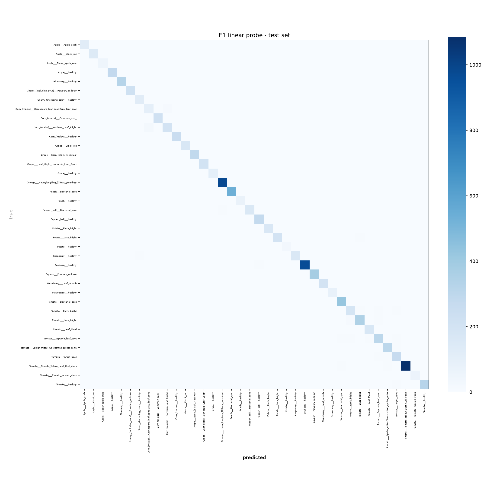

# E1 - linear probe on frozen MobileNetV3-Small

576-d ImageNet features (224x224), multinomial logistic regression on top.

- train: 39,234 images
- val: 4,362 images
- test: 10,709 images
- feature extraction: cached (no re-extraction)

| fit on | evaluated on | top-1 | top-3 | macro-F1 |
|---|---|---:|---:|---:|
| train | val | 0.9757 | 0.9979 | 0.9675 |
| train+val | test | 0.9726 | 0.9988 | 0.9651 |

## Weakest classes (test)

| class | recall | test images |
|---|---:|---:|
| Tomato___Early_blight | 0.856 | 215 |
| Corn_(maize)___Northern_Leaf_Blight | 0.886 | 220 |
| Corn_(maize)___Cercospora_leaf_spot Gray_leaf_spot | 0.897 | 107 |
| Tomato___Septoria_leaf_spot | 0.905 | 337 |
| Potato___healthy | 0.906 | 32 |
| Tomato___Target_Spot | 0.924 | 288 |
| Pepper,_bell___Bacterial_spot | 0.928 | 166 |
| Tomato___Late_blight | 0.931 | 375 |

## Top confusions (test)

| count | true | predicted as |
|---:|---|---|
| 22 | Corn_(maize)___Northern_Leaf_Blight | Corn_(maize)___Cercospora_leaf_spot Gray_leaf_spot |
| 11 | Corn_(maize)___Cercospora_leaf_spot Gray_leaf_spot | Corn_(maize)___Northern_Leaf_Blight |
| 10 | Tomato___Late_blight | Tomato___Early_blight |
| 8 | Tomato___Spider_mites Two-spotted_spider_mite | Tomato___Target_Spot |
| 7 | Tomato___Tomato_Yellow_Leaf_Curl_Virus | Tomato___Spider_mites Two-spotted_spider_mite |
| 7 | Tomato___Septoria_leaf_spot | Tomato___Target_Spot |
| 7 | Potato___Late_blight | Tomato___Late_blight |
| 6 | Tomato___Tomato_Yellow_Leaf_Curl_Virus | Tomato___Bacterial_spot |
| 6 | Tomato___Early_blight | Tomato___Septoria_leaf_spot |
| 6 | Tomato___Early_blight | Tomato___Late_blight |

