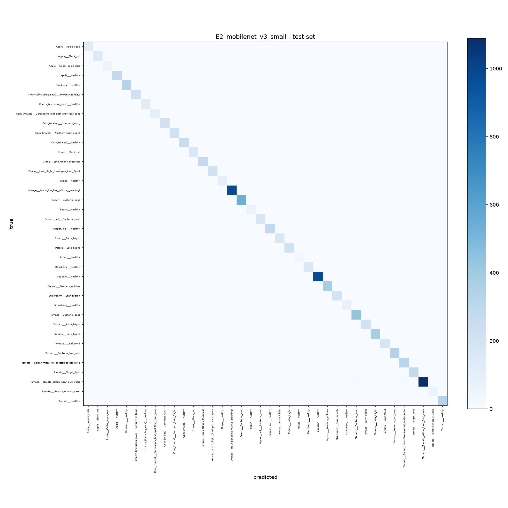

# E2_mobilenet_v3_small - fine-tuned mobilenet_v3_small

- device: GPU, batch 128, 10 epochs, lr 0.0002, label smoothing 0.1
- strong augmentation: False, random background prob: 0.0
- class-weighted loss: True
- test: 10,709 images at 245 img/s

| metric | value |
|---|---:|
| top-1 | 0.9933 |
| top-3 | 0.9997 |
| macro-F1 | 0.9911 |

## Weakest classes (test)

| class | recall |
|---|---:|
| Potato___healthy | 0.906 |
| Tomato___Early_blight | 0.949 |
| Potato___Late_blight | 0.962 |
| Corn_(maize)___Northern_Leaf_Blight | 0.968 |
| Corn_(maize)___Cercospora_leaf_spot Gray_leaf_spot | 0.972 |
| Raspberry___healthy | 0.975 |
| Tomato___Spider_mites Two-spotted_spider_mite | 0.981 |
| Apple___Apple_scab | 0.984 |

## Top confusions (test)

| count | true | predicted as |
|---:|---|---|
| 6 | Tomato___Tomato_Yellow_Leaf_Curl_Virus | Tomato___Spider_mites Two-spotted_spider_mite |
| 6 | Tomato___Spider_mites Two-spotted_spider_mite | Tomato___Target_Spot |
| 6 | Corn_(maize)___Northern_Leaf_Blight | Corn_(maize)___Cercospora_leaf_spot Gray_leaf_spot |
| 5 | Tomato___Tomato_Yellow_Leaf_Curl_Virus | Tomato___Bacterial_spot |
| 5 | Tomato___Early_blight | Tomato___Late_blight |
| 4 | Potato___Late_blight | Tomato___Late_blight |
| 3 | Tomato___Target_Spot | Tomato___Septoria_leaf_spot |
| 3 | Tomato___Early_blight | Tomato___Target_Spot |
| 3 | Potato___Late_blight | Potato___Early_blight |
| 3 | Corn_(maize)___Cercospora_leaf_spot Gray_leaf_spot | Corn_(maize)___Northern_Leaf_Blight |

