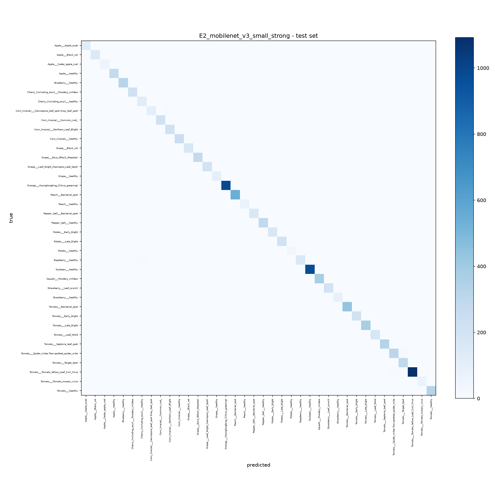

# E2_mobilenet_v3_small_strong - fine-tuned mobilenet_v3_small

- device: GPU, batch 128, 10 epochs, lr 0.0002, label smoothing 0.1
- strong augmentation: True, random background prob: 0.0
- class-weighted loss: True
- test: 10,709 images at 248 img/s

| metric | value |
|---|---:|
| top-1 | 0.9920 |
| top-3 | 0.9997 |
| macro-F1 | 0.9895 |

## Weakest classes (test)

| class | recall |
|---|---:|
| Raspberry___healthy | 0.951 |
| Corn_(maize)___Cercospora_leaf_spot Gray_leaf_spot | 0.953 |
| Potato___Late_blight | 0.967 |
| Tomato___Early_blight | 0.967 |
| Potato___healthy | 0.969 |
| Tomato___Spider_mites Two-spotted_spider_mite | 0.972 |
| Corn_(maize)___Northern_Leaf_Blight | 0.973 |
| Tomato___Septoria_leaf_spot | 0.976 |

## Top confusions (test)

| count | true | predicted as |
|---:|---|---|
| 9 | Tomato___Spider_mites Two-spotted_spider_mite | Tomato___Target_Spot |
| 7 | Raspberry___healthy | Cherry_(including_sour)___healthy |
| 6 | Tomato___Tomato_Yellow_Leaf_Curl_Virus | Tomato___Spider_mites Two-spotted_spider_mite |
| 6 | Potato___Late_blight | Tomato___Late_blight |
| 5 | Corn_(maize)___Cercospora_leaf_spot Gray_leaf_spot | Corn_(maize)___Northern_Leaf_Blight |
| 4 | Corn_(maize)___Northern_Leaf_Blight | Corn_(maize)___Cercospora_leaf_spot Gray_leaf_spot |
| 3 | Tomato___Early_blight | Tomato___Late_blight |
| 3 | Tomato___Bacterial_spot | Tomato___Target_Spot |
| 3 | Grape___Esca_(Black_Measles) | Grape___Black_rot |
| 3 | Apple___healthy | Apple___Black_rot |

